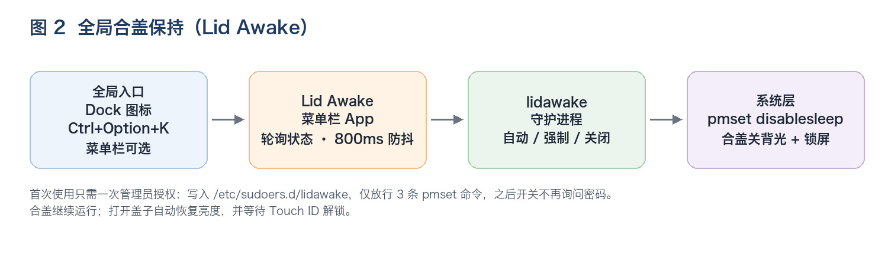

# Lid Awake · 合盖保持

给 macOS 一个全局的「合盖继续跑」开关：**点一下开，再点一下关**。不绑定任何具体应用——编译、下载、跑 agent、长任务都能用。

<p align="center">
  
  &nbsp;&nbsp;&nbsp;&nbsp;
  
</p>

- **Dock 图标**：左键点一下切换；右键「切换合盖保持」
- **Control + Option + K**：任何 App 在前台都能切换
- **菜单栏图标**：空间足够时出现（带刘海的 MacBook 上可能被系统排到刘海下方，所以 Dock 和快捷键是主入口）

开启后合盖：屏幕熄灭、自动锁屏，任务继续运行；打开盖子恢复亮度，用 Touch ID 解锁。

---

## 为什么需要它

`caffeinate` 只能阻止「空闲休眠」。合盖走的是另一条 **clamshell sleep** 路径，断言对它无效。

真正管合盖的是内核标志 `SleepDisabled`，只有 root 能改：

```bash
sudo pmset -a disablesleep 1   # 合盖不睡
sudo pmset -a disablesleep 0   # 恢复
```

而 `SleepDisabled=1` 又会让系统的显示器休眠失效——合盖后屏幕其实还亮着。所以还需要在合盖时主动把背光压到 0。

Lid Awake 把这两件事包成一个按钮，底层使用 [lidawake](https://github.com/richardlinq/lidawake)（已内置在本仓库，Apache-2.0）。



## 安装

要求：

- macOS 13+
- Xcode Command Line Tools：`xcode-select --install`

```bash
git clone https://github.com/Han2233/lid-awake.git
cd lid-awake
./scripts/install.sh
```

安装脚本会：

1. 把内置的 lidawake 运行时复制到 `~/Library/Application Support/lidawake/`，并编译 `dispbright`
2. 编译 App 并安装到 `~/Applications/Lid Awake.app`
3. 注册登录自启（LaunchAgent）
4. 启动 App

也可以只构建不安装：

```bash
make build     # 产物在 build/Lid Awake.app
```

## 首次使用：一次管理员授权

点 Dock 里的咖啡杯（或按 `Control + Option + K`）→ 弹出说明 → 点「授权」→ 输入一次管理员密码。

会在 `/etc/sudoers.d/lidawake` 写入一条**只放行三条命令**的规则：

```text
<你的用户名> ALL=(root) NOPASSWD: /usr/bin/pmset -a disablesleep 1
<你的用户名> ALL=(root) NOPASSWD: /usr/bin/pmset -a disablesleep 0
<你的用户名> ALL=(root) NOPASSWD: /usr/bin/pmset -g
```

写入前会用 `visudo -c` 校验，不会给你其他 sudo 权限。之后所有开关都不再询问密码。

## 用法

| 操作 | 结果 |
|---|---|
| 左键点 Dock 图标 | 开 / 关 |
| `Control + Option + K` | 开 / 关 |
| 右键 Dock 图标 | 「切换合盖保持」 |
| 菜单栏图标右键 | 自动保持、强制保持、恢复正常、合盖锁屏、打开日志 |
| 图标 | 灰色空心 = 关闭；橙色实心 = 保持中 |

三种模式：

| 模式 | 行为 |
|---|---|
| **自动**（默认） | 接电源时一直保持；电池 ≥ 20% 时保持，低于阈值自动释放 |
| **强制** | 忽略电量，一直保持到手动关闭 |
| **正常** | 恢复 macOS 默认：合盖睡眠 |

合盖时默认会锁屏并把背光调到 0；开盖后恢复亮度等待解锁。锁屏只影响界面，不暂停计算。

## 原理

```text
全局入口（Dock / 快捷键 / 菜单栏）
   → Lid Awake.app（状态轮询、800ms 防抖、授权引导）
      → lidawake 守护进程（自动 / 强制 / 正常，电量阈值）
         → pmset disablesleep 1|0
         → dispbright 0|旧亮度（合盖关背光）
         → 合盖时锁屏
```

- `SleepDisabled` 由 `sudo pmset -a disablesleep` 切换，规则来自上面那条 sudoers
- 守护进程每 10 秒检查电量、电源和盖子状态，按模式保持或释放
- 背光通过 DisplayServices 控制（`third_party/lidawake/src/dispbright.c`）

## 安全注意

- 合盖跑重活会积热，不建议塞进包里跑；无风扇的 MacBook Air 更明显
- 强制模式会真的把电池跑空，长任务建议插电
- 合盖锁屏默认开启；关掉它意味着别人打开盖子就能看到桌面
- 不再需要时点一下关闭，或按下面的方式卸载

## 卸载

```bash
./scripts/uninstall.sh
```

会停止 App 与守护进程、恢复 `SleepDisabled 0`、删除 App/运行时/登录项，并请求一次管理员密码删除 sudoers 规则。

## 目录结构

```text
.
├── LidAwake.swift            # 菜单栏 / Dock App（Swift，单文件）
├── Info.plist
├── scripts/
│   ├── build.sh              # 只构建
│   ├── install.sh            # 运行时 + App + 登录自启
│   └── uninstall.sh
├── assets/                   # 图标与架构图
├── third_party/lidawake/     # 上游 lidawake v0.2.0（Apache-2.0）
├── Makefile
└── LICENSE
```

## 已知限制

- 菜单栏图标在刘海屏上可能被系统排到刘海下方；请用 Dock 图标或快捷键
- 只支持 macOS（Apple Silicon 已实测；Intel 理论可用，未验证）
- 需要 Xcode Command Line Tools，因为要编译 App 和 `dispbright`

## 致谢与许可

- 本仓库代码：MIT，见 [LICENSE](LICENSE)
- [lidawake](https://github.com/richardlinq/lidawake)：Apache-2.0，内置版本 v0.2.0（9ba9476），见 [third_party/lidawake](third_party/lidawake/)
- Dock 图标由 SF Symbols 的 `cup.and.saucer` 绘制
